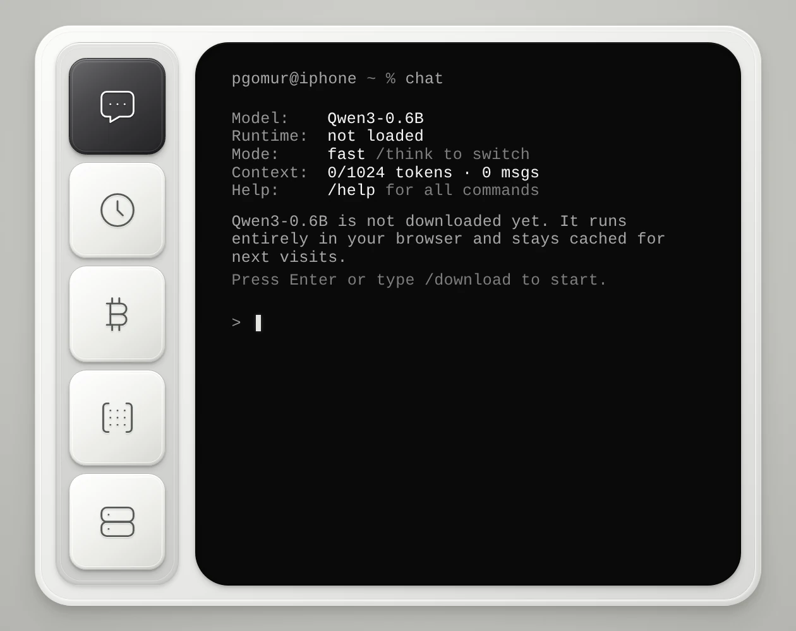
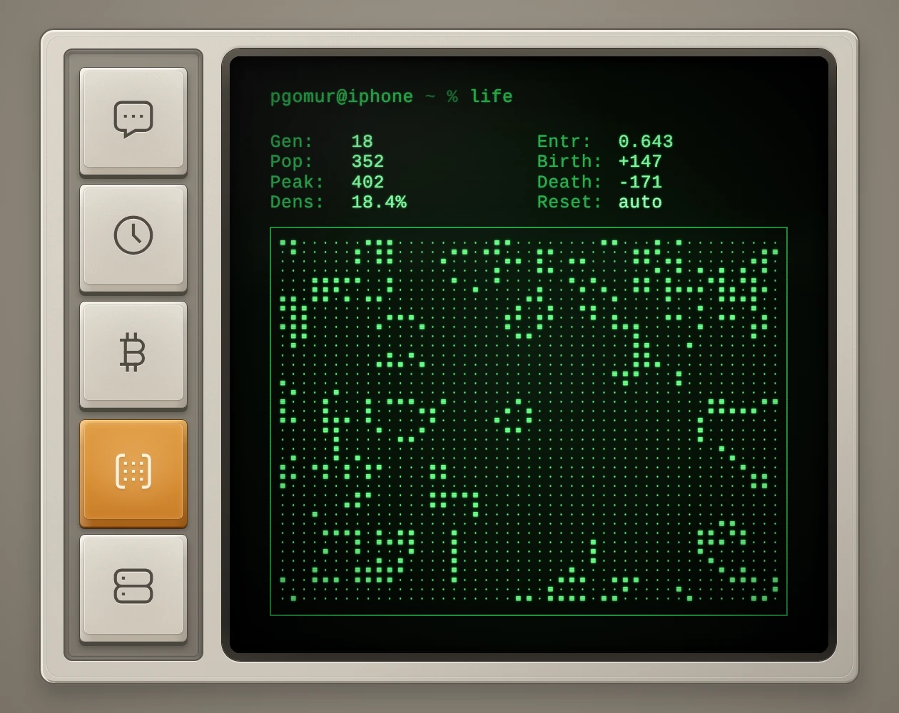

# Pocket Terminal

  
  
  
  
  
  
  

**Visual and interactive concept / prototype.** A personal terminal in the form of a pocket device, rendered entirely in the browser. It is not an emulator or a general-purpose app: it's a UX and design exploration of what a terminal GUI would feel like inside a physical gadget — housing, navigation rail and glass screen — built only with web technologies.

Each app behaves like a terminal session, with its own prompt (`pgomur@iphone ~ %`) and everything shown as text, with no native widgets.

| Soft Skeuo | Glass Optical | Retro CRT |
| :---: | :---: | :---: |
|  |  |  |

## Apps

- **Chat**: Qwen3-0.6B running 100% in your browser on WebGPU (or WASM as a fallback), with no server and no external API. The model downloads only when you ask for it and stays cached for later visits, replies stream token by token and an optional thinking mode reasons before answering. Type `/help` to see every command.
- **Clock**: a drift-free clock with day, week, month and year progress bars, ISO week number, day of year and Unix time.
- **Bitcoin**: live price and 24h metrics from CoinGecko with a 7-day chart drawn on the terminal's character grid, refreshed every minute.
- **Life**: Conway's Game of Life that keeps itself alive — rotating seeds, cycle and stagnation detection, and live metrics including Shannon entropy.
- **System**: the real device and browser behind the screen: OS, browser, GPU, CPU cores, memory, screen, WebGPU support and more.

## Themes and 3D view

Three themes, switchable instantly from the selector in the top-right corner: **Soft Skeuo** (soft white plastic), **Glass Optical** (frosted glass over a misty blue background) and **Retro CRT** (beige plastic and a green phosphor tube).

An optional **3D view** rebuilds the device in Three.js, with modelled keys and materials matched to each theme, while the screen stays live and selectable. Drag outside the device to rotate it; on Android phones it also follows the gyroscope.

The device adapts to any screen size, from desktop to phone, and is fully keyboard accessible: arrow keys move between apps, `1`–`5` open them directly and every theme shows a clear focus outline.

## Known limitations

- The chat model is small (0.6B parameters) so it can run in the browser: it's a local-inference experiment, not a reliable assistant.
- In System, memory and JS heap rely on Chromium-only APIs and show as unavailable in Firefox and Safari.
- The Bitcoin data comes from CoinGecko's public API, which is rate-limited.
- The 3D view needs WebGL 2; without it the device stays in the flat view.
- Apart from the selected theme and view, nothing is saved: the chat and the Game of Life start over on reload.

> **Source:** [Private Repo](https://github.com/pgomur/pocket-terminal-concept-priv)
