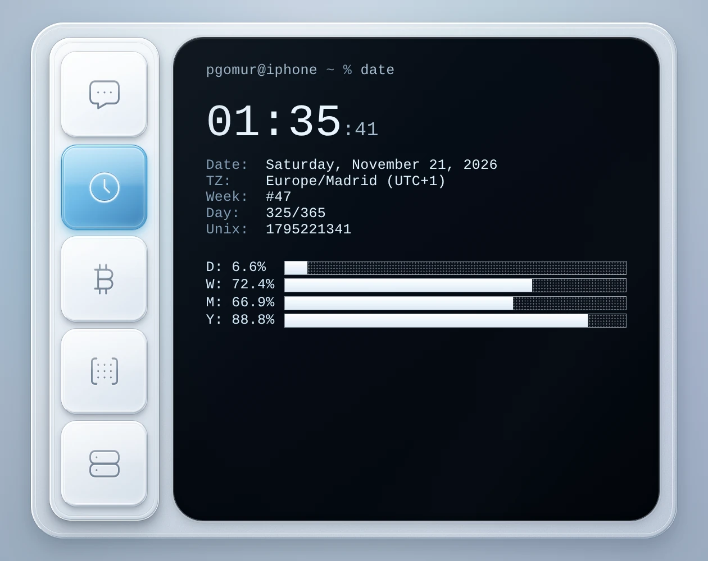

# Pocket Terminal

  
  
  
  
  
  

**Visual and interactive concept / prototype.** A personal terminal in the form of a portable device (a "pocket device"), rendered entirely in the browser. It is not an emulator or a general-purpose functional app: it's a UX and design exploration studying what it would be like to embed a terminal GUI in a physical pocket gadget (housing, navigation rail, and glass screen) using only web technologies.

Each application behaves like a terminal session: it shows its own prompt (`pgomur@iphone ~ %`) and exposes all information through a textual representation, with no native widgets.

> **Source:** [Private Repo](https://github.com/pgomur/pocket-terminal-concept-priv)

## Screenshots

| Soft Skeuo | Glass Optical | Retro CRT |
| :---: | :---: | :---: |
|  |  |  |

## Rendering architecture

The device is built entirely from Svelte-generated DOM/CSS — housing, screen, and applications alike. The device's scale is responsive via container query units relative to the actual width of the container, so a single pixel-based design spec adapts to any screen size; a small-screen media query (760 px) adjusts the housing width, paddings and rail button sizing.

The terminal text size is a single shared variable (`--terminal-font-size`) used by every theme. It scales with the device between 15 and 31 px; below 760 px it scales more finely, between 11 and 15 px (11 px on a 390 px phone), so lines are not broken on narrow screens.

The five apps are declared once in an app registry (id, label, icon, component). The app identifier type, the navigation rail and the screen are all derived from it, so adding an app is a one-line change; the screen renders the active app's component dynamically and the rail is bidirectionally bound to the active app. Icons are custom-drawn SVGs with no external icon library; each theme sets their stroke width, line caps and relief.

## Applications

### Chat

A text assistant running **100% client-side** — no server, no external API — via Hugging Face's transformers library, which runs the Qwen3-0.6B model (thinking disabled by default) inside a Web Worker.

- **Download on request**: opening the app never downloads the model. The worker first checks whether the model file for the current runtime is already in the browser cache and, if so, loads it from there without downloading anything. Otherwise the app shows the approximate download size (read from the Hugging Face API) and waits until the user presses Enter on an empty line or types `/download`. A download in progress can be cancelled with Ctrl+C or `/cancel`.
- **Terminal input**: what you type goes into a real, visually hidden text field laid over the `>` line, while the screen keeps drawing the terminal text and the theme's block cursor at the actual caret position. This brings the on-screen keyboard on touch devices, paste, IME composition and screen-reader support; ↑/↓ browse the message history.
- **Runtime detection**: the worker checks for WebGPU availability and uses 4-bit weights with fp16 activations (`q4f16`); if that fails, it falls back to WASM with 4-bit weights (`q4`). The actual runtime/precision combination is shown on screen.
- **Streaming and interruption**: tokens are streamed to the screen as they are generated. Ctrl+C or `/stop` interrupts the reply and keeps the partial text.
- **Two modes**: *fast* (default, thinking disabled; up to 256 new tokens, temperature 0.7, top-p 0.8, top-k 20) and *thinking* (`/think`; the model reasons before answering; up to 1024 new tokens, temperature 0.6, top-p 0.95, top-k 20). These are the sampling values Qwen recommends for each mode. While thinking, the reasoning is streamed in a dimmed line that collapses into "(thought for Xs)" when the answer arrives; only final answers are kept in the conversation history.
- **System prompt**: gives the assistant a name and role, asks it to answer the latest message directly in the user's language, in plain text and briefly, not to repeat earlier replies, to admit uncertainty instead of inventing facts, and includes today's date.
- **Token-based context window**: the prompt budget (512–4096 tokens) is computed from the runtime, CPU cores and memory. The worker measures the real prompt with the model's tokenizer and drops the oldest messages until it fits; kept/dropped messages and prompt tokens are shown on screen.
- **Model management from the terminal itself**: `/help`, `/download`, `/cancel`, `/stop`, `/think`, `/clear` (keeps the model loaded) and `/delete` (purges the browser cache that stores the model).
- **Download progress**: a single progress bar aggregates the bytes of every model file.

### Clock

A digital clock synced to the second boundary: the first tick is scheduled to occur exactly at the start of the next second, and periodic ticks follow from there without accumulating drift. It computes day, week (Monday to Sunday), month, and year progress as a percentage; ISO 8601 week number, day of year (with leap-year correction), Unix timestamp, and UTC offset.

### Bitcoin

Live data from the CoinGecko API (instant price with aggregated metrics and a 7-day historical series at hourly resolution), refreshed every 60 seconds.

- **Resilient refresh**: the data lives in a module-level feed, so switching apps keeps the last values and does not refetch while they are fresh. Refreshing pauses while the tab is hidden; after a failure it backs off exponentially (60 s up to 10 min, honouring `Retry-After` on HTTP 429) and keeps showing the last good data with the time of the next retry.
- **24h change** is drawn in the theme's positive or danger colour depending on its sign.
- **Price chart**: a terminal-style chart drawn as SVG on the character grid of the screen, so it looks the same with any font and device. The 7-day series is averaged in buckets of about one and a half characters and drawn as a smooth monotone curve, which never goes above the highest or below the lowest point. The Y axis has a tick per row and 4 compact price labels right-aligned to the widest one; the X axis marks -7d, -5d, -3d, -1d and now at their real position in the week, dropping a middle marker when it would touch its neighbour.
- **Reactive typographic measurement**: a hidden element measures the width of a character and the line height of the terminal font, and a resize observer on the container and its parent element recomputes the chart when the size changes.
- **24h high/low** derived from the last 24 hourly points of the series, not from the endpoint.

### Life

Conway's Game of Life on a toroidal grid (the neighborhood wraps around the edges), where each cell stores its age — consecutive generations alive — instead of a boolean state, which allows styling cells by longevity.

- **Rotating seed generator**: four curated archetypes chosen cyclically — dense clusters of viable polyominoes with a central methuselah; quarter-turn symmetry generated from coordinate pairs; opposing spaceship fleets with a central methuselah; and a glider gun or a puffer train with corner blocks.
- **Autonomous lifecycle**: the board runs autonomously with a 140ms tick. It detects closed cycles via a fast 32-bit hash of the boolean grid (a 48-generation window), stagnation (identical population with zero changes for 4 generations), and static low density. Before resetting, it injects up to 3 spaceships as a kinetic perturbation to revive the board; if the board does not recover, it reseeds. A reseed is also forced upon reaching 800 generations or zero population.
- **Per-generation metrics**: population, percentage density, births and deaths, historical peak, and normalized Shannon entropy, computed over the distribution of the 16 possible 2×2 block patterns of the toroidal grid.
- **Fit-to-screen**: the number of columns and rows is derived from the real character width and the container's available height (subtracting its fixed siblings), with automatic reseeding on resize.

### System

An inventory of the device and the actual browser environment: operating system and browser detected via heuristics on the user agent (with guards to avoid false positives between Chrome, Safari, and Edge); the actual GPU renderer obtained through the WebGL debug info extension; CPU cores, device memory, screen resolution versus viewport, and device pixel ratio; WebGPU support; preferred color scheme; timezone, language, and cookies. The JavaScript process heap is sampled every second.

## 3D view

An optional 3D view, chosen in the selector under **View**, rebuilds the device in Three.js and keeps the screen as real DOM. Three.js is loaded on demand only when the 3D view is turned on.

- **Modelled housing**: the body, the rail and the keys are extruded from the device's own layout (sizes, corner radii and positions are read from the DOM), with rounded edges, depth and a soft drop shadow. Edge roundness is capped by the tightest gap between parts so the geometry stays valid at every size.
- **Physical keys**: each app button is a modelled key with its icon on top; the active key sits slightly lower in the theme accent and keys travel down when pressed with the pointer or with Enter/Space. The keyboard focus outline is drawn on the key itself, so it follows the key when the device tilts or the key goes down.
- **Real screen**: the screen is the live DOM, projected with a CSS `matrix3d` that follows the 3D camera, so text stays sharp and selectable and the screen has no glare. The DOM housing and keys stay in place but invisible, so clicks, focus, keyboard navigation and screen readers keep working exactly as in the flat view.
- **Camera**: the device tilts up to 6° towards the pointer (or with the gyroscope on touch devices) and can be turned up to 20° by dragging the empty background around it; it springs back on release. A hint next to the theme selector (below it on narrow screens) says to drag outside the device. With `prefers-reduced-motion` the pointer and gyroscope tilt are disabled.
- **Materials from the theme's CSS**: borders, inner rings, inset and drop shadows and sheens of the housing, rail and keys are read from the live stylesheet and painted on the model, so the 3D device keeps the details of the flat one.
  - **Soft Skeuo**: matte plastic with a raised rail. Its gradients come from the theme's CSS tokens and the lighting is calibrated so that, seen from the front, the colours match the flat view.
  - **Glass Optical**: physically based glass that refracts the misty backdrop drawn inside the scene — frosted housing, clear keys with a milky body, a dark-blue glass active key and a satin opaque rail. The backdrop light follows the active app, as in the flat view.
  - **Retro CRT**: the same calibrated approach as Soft Skeuo, with 80s keycaps whose flat face and sloped walls sit exactly where the CSS draws them, a recessed rail, matte plastic with grain and a backlit amber active key.
  - A theme without a tuned look falls back to materials derived from its swatch colours.
- **Support**: any browser with WebGL 2. Without it the option is shown as unavailable; if the 3D view fails to start it falls back to flat on its own.

## Themes

There are three themes. Each one pairs a housing material with its own screen and accent:

- **Soft Skeuo** (default): soft white plastic, a graphite active key and a neutral black screen.
- **Glass Optical**: a frosted glass housing over a misty blue background whose soft light follows the active app, translucent keys with etched icons and a dark-blue active key, and a bluish screen with ice-white progress bars.
- **Retro CRT**: beige plastic with grain, a recessed rail, 80s keycaps with an amber active key, and a CRT tube in a dark bezel with green phosphor glow, scanlines, a slow sweep and a subtle flicker. The sweep and the flicker stop with `prefers-reduced-motion`.

- **Shared structure**: layout and structural rules common to every theme live in a base stylesheet. Each theme is a folder with the same five parts — `tokens`, `housing`, `controls` (rail, keys and icons), `screen` (terminal, progress and cursor) and `responsive` — joined by an `index.css` that is bundled into a single stylesheet. The default theme is bundled with the app and the others are loaded on demand the first time they are selected. Switching themes swaps the stylesheet text in place, with no page reload and no re-render of the application.
- **Token contract**: all themes expose the same CSS variables used by the apps and the selector — ink and its bright/dim levels, labels, icons, screen, cursor, the semantic `--danger` and `--positive` colours and the selector colours — so no component knows or depends on the active appearance. Housing, rail and key tokens are each theme's own.
- **Typed identifiers**: the theme type is derived from the theme list, so a theme without a stylesheet is a compile-time error. An unknown value stored in the browser falls back to the default theme.
- **Browser chrome**: the `theme-color` meta tag follows the active theme.

The theme and view selections persist locally in the browser across sessions. The selector is a menu button in the top-right corner, outside the device itself: it opens with click, Enter, Space or the arrow keys, moves with ↑/↓/Home/End, and closes with Escape, Tab or a click outside, returning focus to the button.

## Keyboard and accessibility

- **Navigation rail**: one tab stop; ↑/↓ move between apps, Home/End jump to the first/last one, Enter/Space open the focused app. The active app is marked with `aria-current="page"`.
- **Shortcuts**: `1`–`5` open Chat, Clock, Bitcoin, Life and System. They are ignored with modifier keys, while typing in a text field, and inside Chat, where digits are part of the message.
- **Focus**: every theme draws a visible outline around the focused key, in the flat and in the 3D view.
- **Screen readers**: the chat conversation is a live log that waits for each reply to finish before announcing it; the Game of Life board and the Bitcoin chart are exposed as images with a text summary instead of hundreds of glyphs.

## Tests

Unit tests cover the pure modules: the Game of Life engine, the clock metrics (ISO weeks, leap years, DST days), the Bitcoin chart geometry, the chat context budget, the reasoning parser, the view mode, WebGL 2 detection and the 3D maths — housing colours, theme tokens read for the 3D view, keycap geometry, calibrated lighting, the glass backdrop and the DOM-to-3D layout. They run in the `Europe/Madrid` time zone so date tests behave the same on any machine.

## Deployment

The app is a static site deployed to Cloudflare Pages.

- **No bundled ONNX Runtime binary**: a small Vite plugin removes the ONNX Runtime `.wasm` that would otherwise be copied into `dist/` (it exceeds the Pages per-file limit). Transformers.js loads that binary from the jsDelivr CDN at runtime.
- **Cross-origin isolation**: `public/_headers` sets `Cross-Origin-Opener-Policy: same-origin` and `Cross-Origin-Embedder-Policy: credentialless`, which make `SharedArrayBuffer` available so the WASM backend can run multi-threaded. The development and preview servers send the same headers.

## Known limitations

- **Chat**: the model has 0.6B parameters so it can run entirely in the browser without a server. At that size, coherence and reasoning ability are limited — this is a local-inference experiment, not a reliable assistant for factual queries.
- **System**: several fields depend on non-standard APIs exposed only by Chromium-based browsers (device memory, WebGPU). On Firefox or Safari they will show as unavailable; this is a platform constraint, not an app bug.
- **Bitcoin**: uses the public, unauthenticated CoinGecko API, which is subject to a per-IP rate limit. Heavy use in a short time can cause temporary load failures.
- **Multi-threaded WASM**: browsers that do not support COEP `credentialless` are not cross-origin isolated and run the WASM backend single-threaded.
- **3D view**: the screen is a DOM layer drawn over the WebGL scene, so at steep angles it cannot be hidden behind the housing edge; tilt is limited to keep that invisible.
- **Persistence**: aside from the selected theme and view, all state (chat conversation, Game of Life progress, etc.) lives in memory for the session and is lost on page reload.

